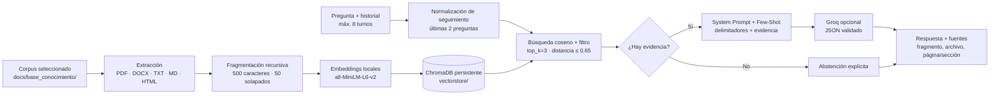

# CrianzApp — Crianza con calma

Asistente web de orientación general sobre crianza positiva. El sistema
recupera fragmentos de documentos locales, presenta las fuentes y, si se
configura `GROQ_API_KEY`, usa Groq para redactar una respuesta conversacional
restringida a esa evidencia.

## Flujo RAG implementado



El diseño, decisiones, limitaciones, evidencia y estado de evaluación se
explican en [docs/flujo_completo_rag.md](docs/flujo_completo_rag.md). La
entrega tiene también el [PDF](docs/entrega_avance2.pdf) y su fuente
[HTML](docs/entrega_avance2.html); el diagrama está en
[docs/diagrama_flujo_rag.svg](docs/diagrama_flujo_rag.svg). El informe
distingue los resultados realmente medidos de los pendientes; no se estiman
scores que Ragas no haya generado.

### Corpus

El índice recorre `docs/base_conocimiento/` y procesa los documentos
compatibles. El corpus versionado actual contiene los tres materiales de
participante TBRI (Conexión, Corrección y Empoderamiento), el artículo de
Gómez Muzzio sobre psicoterapia y apego, la revisión sistemática de
intervenciones digitales de crianza y `guia_crianza.md`. Se seleccionaron
porque cubren apego, interacción cuidador-niño, corregulación, disciplina y
apoyo parental, directamente pertinentes a la orientación del asistente.
El notebook `flujo_rag_groq.ipynb` es material de implementación, no fuente
de conocimiento, y no se vectoriza.

Los formatos aceptados son PDF, DOCX, TXT, Markdown y HTML (`.html`/`.htm`).
PDF usa metadatos de página; DOCX/Markdown/HTML/TXT usan sección o nombre de
archivo. El splitter es `RecursiveCharacterTextSplitter` de 500 caracteres,
solapamiento de 50 y separadores por párrafo, salto de línea, espacio y
carácter. Chroma persiste los textos, metadatos e índices en `vectorstore/`.
El embedding explícito es `sentence-transformers/all-MiniLM-L6-v2`, ejecutado
localmente por la función predeterminada de Chroma; es compacto y no requiere
llaves ni llamadas remotas para vectorizar. Es una limitación conocida que no
sea multilingüe y se documenta como mejora candidata.

La búsqueda obtiene candidatos por similitud coseno; se conservan hasta tres
fragmentos que cumplan distancia máxima 0.65 y un solapamiento léxico mínimo
con la consulta. En seguimientos, se añaden las dos preguntas anteriores a la
consulta de recuperación. El modelo recibe hasta ocho turnos en el prompt.
Sin evidencia aceptable, la respuesta es: “No dispongo de esa información en
la base de conocimientos”.

## Instalación y ejecución

Requiere Python 3.12.8, fijado en `.python-version`.

```bash
python -m venv .venv
source .venv/bin/activate
python -m pip install -r requirements.txt
cp .env.example .env
python main.py
```

Completa localmente `GROQ_API_KEY` para habilitar generación con Groq.
`GOOGLE_API_KEY` solo se requiere para ejecutar Ragas. `.env` está ignorado por
Git y se carga desde la raíz; nunca incluyas claves en commits o capturas.
Sin clave de Groq, el backend devuelve los fragmentos relevantes en modo
extractivo. Abre `http://localhost:5000`.

### API

- `GET /`: interfaz de conversación.
- `GET /api/health`: disponibilidad, cantidad de chunks y estado del LLM; no
  devuelve secretos.
- `POST /chat` y alias `POST /api/chat`: JSON `{ "message": "...",
  "history": [{"role": "user|assistant", "content": "..."}] }`; devuelve
  `respuesta`, `fuentes`, `mode` y `notice`, además de alias en inglés.
- Las fuentes tienen archivo, extracto, `chunk_id` y página/sección disponible.

## Evaluación Ragas

`eval_dataset.json` contiene 15 preguntas: 12 en dominio y 3 fuera de dominio,
con `ground_truth`. Las cuatro métricas Ragas se calculan solo para las
preguntas en dominio, donde la referencia representa contenido recuperable.
Para las preguntas fuera de dominio se reporta por separado la tasa de
abstención correcta; `context_recall` no es una medida válida para una
referencia que explícitamente dice que el dato no está en el corpus.

```bash
GOOGLE_API_KEY=... python eval_ragas.py
```

El script carga `.env`, usa Gemini configurado en `RAGAS_LLM_MODEL` y
`RAGAS_EMBEDDING_MODEL`, imprime promedios y guarda `ragas_results.json`.
La clave y el endpoint de Google deben tener cuota y acceso a ambos modelos.
No se deben informar resultados hasta que el proceso termine y guarde el JSON.

Para reproducir una iteración y guardar sus resultados aparte:

```bash
RAG_CHUNK_SIZE=500 RAG_CHUNK_OVERLAP=50 RAG_TOP_K=3 \
RAGAS_RESULTS_PATH=ragas_baseline.json python eval_ragas.py

RAG_CHUNK_SIZE=500 RAG_CHUNK_OVERLAP=50 RAG_TOP_K=4 \
RAGAS_RESULTS_PATH=ragas_topk4.json python eval_ragas.py
```

El índice se reconstruye al detectar cambios en el corpus o configuración de
fragmentación. Compara los promedios de los cuatro scores y la tasa de
abstención; adopta el cambio solo si mejora las métricas pertinentes sin
degradar la abstención. Estos comandos describen el protocolo, no resultados
ya medidos.

## Despliegue

El blueprint de Render está en `render.yaml`. Conecta el repositorio como
Blueprint y configura `GROQ_API_KEY` como secreto; `GROQ_MODEL` tiene un valor
predeterminado. El comando de inicio es Gunicorn con un worker y crea el
índice al arrancar. El almacenamiento del plan gratuito puede ser efímero,
por lo que el índice se reconstruye en cada despliegue.

- Repositorio: [github.com/Criss190/AsistenteCrianza](https://github.com/Criss190/AsistenteCrianza)
- URL pública: pendiente de verificar. La dirección probada
  `https://crianzapp.onrender.com` respondió HTTP 404; no debe presentarse
  como despliegue funcional hasta confirmar la URL generada por Render.

## Alcance y seguridad

El asistente brinda información general; no diagnostica ni reemplaza atención
profesional. Señales de abuso, violencia o autolesión tienen una respuesta de
seguridad prioritaria. En Colombia se informa la línea ICBF 141 y emergencias
123. Al habilitar Groq, la pregunta, historial y fragmentos recuperados se
envían a ese proveedor. No incluyas datos identificables de niños o niñas.
