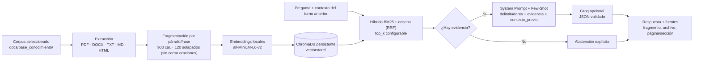

# CrianzApp — Crianza con calma

Asistente web de orientación general sobre crianza positiva. El sistema
recupera fragmentos de documentos locales, presenta las fuentes y, si se
configura `GROQ_API_KEY`, usa Groq para redactar una respuesta conversacional
restringida a esa evidencia.

## Flujo RAG implementado



La auditoría y requisitos están en
[docs/architecture/01-auditoria.md](docs/architecture/01-auditoria.md) y
[docs/architecture/02-requisitos-y-casos-de-uso.md](docs/architecture/02-requisitos-y-casos-de-uso.md).
El detalle del pipeline, sus decisiones técnicas y el estado de evaluación
están en [docs/flujo_completo_rag.md](docs/flujo_completo_rag.md).

### Corpus

El corpus definitivo contiene cinco PDF: los tres materiales de participante
TBRI (Conexión, Corrección y Empoderamiento), el artículo de Gómez Muzzio
sobre psicoterapia y apego, y la revisión sistemática de intervenciones
digitales de crianza. El Markdown provisional `guia_crianza.md` fue retirado
y se excluye explícitamente de la ingestión; los PDF originales se conservan.
Los documentos Markdown derivados de esos PDF siguen siendo formatos válidos.

Los formatos aceptados son PDF, DOCX, TXT, Markdown y HTML (`.html`/`.htm`).
PDF usa metadatos de página; DOCX/Markdown/HTML/TXT usan sección o nombre de
archivo. El splitter (`src/knowledge_base.py`) es propio, no
`RecursiveCharacterTextSplitter`: agrupa párrafos completos y, si exceden el
tamaño, baja a frases y luego a palabras, sin cortar nunca a mitad de oración;
arrastra al fragmento siguiente las últimas unidades del anterior hasta el
solapamiento configurado. El tamaño/solapamiento por defecto es 900/120
caracteres, pero `.env`/Render los fijan en 500/50 vía `RAG_CHUNK_SIZE` y
`RAG_CHUNK_OVERLAP` (ver sección de evaluación para la comparación entre
configuraciones). Chroma persiste los textos, metadatos e índices en
`vectorstore/`. El embedding explícito es `sentence-transformers/all-MiniLM-L6-v2`,
ejecutado localmente por la función predeterminada de Chroma; es compacto y no
requiere llaves ni llamadas remotas para vectorizar. Es una limitación conocida
que no sea multilingüe y se documenta como mejora candidata.

La recuperación es híbrida: BM25 sobre raíces de palabras en español (señal
principal, ponderada por coincidencia con la pregunta y su expansión al
vocabulario TBRI) combinada con similitud coseno vía fusión por rango
recíproco (RRF); se conservan hasta `top_k` fragmentos que superen un umbral
mínimo de evidencia léxica. Si la pregunta sola no encuentra nada y hay un
turno anterior, el sistema reintenta la búsqueda con la pregunta reformulada
de forma autónoma (con Groq si hay clave, o por combinación léxica simple en
modo local) para resolver seguimientos elípticos ("¿y el segundo?"). La
clasificación de riesgo de seguridad depende solo del mensaje actual, nunca
del historial. Sin evidencia aceptable, el asistente explica que su
especialidad es la crianza responsable y que no encontró información
suficiente para responder con seguridad.

### Memoria conversacional

El frontend mantiene el historial visual de la conversación (hasta 4
intercambios) y lo envía con cada mensaje. El backend lo usa de dos formas: (1)
como respaldo de recuperación cuando la pregunta actual sola no basta, y (2)
como `contexto_previo` para la generación, exclusivamente para interpretar
referencias ("eso", "el segundo") — nunca como fuente de hechos citables. El
historial se trunca a los últimos turnos y nunca influye en la clasificación de
riesgo, que siempre evalúa solo el mensaje actual.

## Instalación y ejecución

Requiere Python 3.12.8, fijado en `.python-version`.

```bash
python -m venv .venv
source .venv/bin/activate
python -m pip install -r requirements.txt
cp .env.example .env
python main.py
```

Completa localmente `GROQ_API_KEY` para habilitar generación con Groq.
`GOOGLE_API_KEY` solo se requiere para ejecutar Ragas. `.env` está ignorado por
Git y se carga desde la raíz; nunca incluyas claves en commits o capturas.
Sin clave de Groq, el backend devuelve los fragmentos relevantes en modo
extractivo. Abre `http://localhost:5000`.

### API

- `GET /`: interfaz de conversación.
- `GET /api/health`: disponibilidad, cantidad de chunks y estado del LLM; no
  devuelve secretos.
- `POST /chat` y alias `POST /api/chat`: JSON `{ "message": "...", "history": [...] }`.
  `history` son los últimos turnos `{role, content}` de la conversación (el
  frontend conserva hasta 4 intercambios); el backend los usa para resolver
  seguimientos elípticos y dar contexto a la generación, nunca como fuente de
  hechos ni para decidir riesgo de seguridad. Devuelve `respuesta`, `fuentes`,
  `mode` y `notice`, además de alias en inglés.
- Las fuentes tienen archivo, extracto, `chunk_id` y página/sección disponible.

## Evaluación Ragas

`scripts_ragas/questions/eval_dataset.json` contiene 15 preguntas: 12 en dominio y 3 fuera de dominio,
con `ground_truth`. Las cuatro métricas Ragas se calculan solo para las
preguntas en dominio, donde la referencia representa contenido recuperable.
Para las preguntas fuera de dominio se reporta por separado la tasa de
abstención correcta; `context_recall` no es una medida válida para una
referencia que explícitamente dice que el dato no está en el corpus.

```bash
GOOGLE_API_KEY=... python scripts_ragas/eval_ragas.py
```

El script carga `.env`, usa Gemini configurado en `RAGAS_LLM_MODEL` y
`RAGAS_EMBEDDING_MODEL`, imprime promedios y guarda `scripts_ragas/results/ragas_results.json`
(o la ruta indicada en `RAGAS_RESULTS_PATH`). La clave y el modelo de Google
deben tener cuota disponible; el plan gratuito de algunos modelos de Gemini
(p. ej. `gemini-3.8-flash`) limita a 5 solicitudes/minuto, insuficiente para
esta evaluación — `RAGAS_LLM_MODEL=gemini-3.5-flash-lite` (15/min) funciona
de forma confiable.

**Resultados reales** (análisis completo, con atribución por componente, en
[docs/flujo_completo_rag.md](docs/flujo_completo_rag.md#8-evaluación-con-ragas)):

| Métrica | 500/50, top_k=3 ([json](scripts_ragas/results/ragas_baseline.json)) | 900/120, top_k=4 — adoptada ([json](scripts_ragas/results/ragas_900_120_4.json)) |
|---|---|---|
| faithfulness | 0.555 | 0.540 |
| answer_relevancy | 0.693 | 0.614 |
| context_precision | 0.417 | 0.569 |
| context_recall | 0.333 | 0.409 |
| Abstención fuera de dominio | 3/3 (100%) | 3/3 (100%) |

La métrica más baja en ambas corridas es de recuperación
(`context_recall`/`context_precision`), no de generación: varios fragmentos
con la respuesta exacta no entraban en el `top_k`. Subir chunk/overlap/top_k
mejoró ambas métricas de recuperación a costa de una pequeña baja en
`answer_relevancy`/`faithfulness` (fragmentos más grandes traen más texto
no relacionado con la pregunta puntual). El índice se reconstruye solo al
detectar cambios en el corpus o en estos parámetros.

## Despliegue

La configuración recomendada es Railway (Flask + Gunicorn); los parámetros
están en `railway.json`. Para publicarla:

1. En Railway, crea un proyecto con **Deploy from GitHub repo** y selecciona
   `Criss190/AsistenteCrianza` (o conecta tu fork).
2. En las variables del servicio, agrega `GROQ_API_KEY` como secreto para
   habilitar respuestas generativas. `GROQ_MODEL` es opcional; por defecto es
   `openai/gpt-oss-120b`. Sin la clave, la app sigue funcionando en modo local.
3. Para conservar el índice entre despliegues, agrega un volumen al servicio
   montado en `/data` y define `RAG_VECTORSTORE_DIR=/data`. Sin volumen,
   Chroma se reconstruye desde los documentos versionados al iniciar.
4. Espera a que el health check de `/api/health` pase y abre el dominio público
   que Railway genera en **Settings → Networking → Generate Domain**.
5. Comprueba que `/api/health` devuelva `status: "ok"`, `knowledge_chunks`
   mayor que cero y, si configuraste la clave, `llm_configured: true`.

Railway puede requerir un plan con créditos o facturación habilitada; revisa
sus precios antes de publicar. No subas `.env` ni pegues claves en GitHub. El
archivo `render.yaml` se conserva para el despliegue alternativo en Render.

- Repositorio: [github.com/Criss190/AsistenteCrianza](https://github.com/Criss190/AsistenteCrianza)
- URL pública: se genera al crear el dominio en el proveedor; aún no está
  configurada ni verificada.

## Alcance y seguridad

El asistente brinda información general; no diagnostica ni reemplaza atención
profesional. Señales de abuso, violencia o autolesión tienen una respuesta de
seguridad prioritaria. En Colombia se informa la línea ICBF 141 y emergencias
123. Al habilitar Groq, la pregunta actual y los fragmentos recuperados se
envían a ese proveedor. No incluyas datos identificables de niños o niñas.
