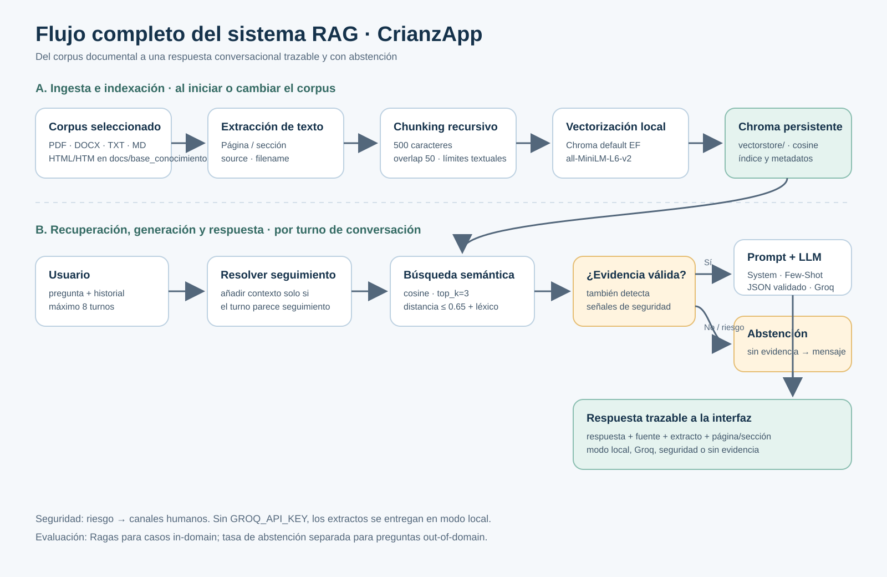

# Flujo completo del sistema RAG

## 1. Propósito y corpus

CrianzApp brinda orientación general sobre crianza positiva a cuidadores de
niños y niñas de 0 a 12 años en Colombia. El índice incorpora solo documentos
de `docs/base_conocimiento/` que tratan explícitamente de desarrollo, apego,
relación cuidador-niño, disciplina, corregulación y apoyo parental:

| Archivo | Pertinencia para el dominio |
|---|---|
| `02. (español) TBRI Conexion participante.pdf` | Material de conexión y relación adulto-niño. |
| `03. (español) TBRI Correccion participante.pdf` | Orientación sobre corrección de conductas y límites. |
| `04. (español) TBRI Empoderamiento participante.pdf` | Regulación, necesidades y preparación del niño. |
| `34. Gomez Muzzio.pdf` | Artículo sobre psicoterapia infantil, apego y sensibilidad parental. |
| `39.pdf` | Revisión sistemática sobre intervenciones digitales de apoyo parental. |
| `guia_crianza.md` | Guía del proyecto para situaciones cotidianas de crianza. |

El notebook `flujo_rag_groq.ipynb` se conserva como artefacto de desarrollo y
no se indexa: no es una fuente primaria de orientación. El cargador también
admite documentos PDF, DOCX, TXT, MD y HTML (`.html`/`.htm`) añadidos al
directorio. Formatos que no estén en `EXTENSIONES_ADMITIDAS` se ignoran.

## 2. Diagrama del pipeline



Pipeline durante el arranque:

1. Enumerar recursivamente archivos admitidos y extraer texto.
2. Añadir metadatos de procedencia y ubicación a cada documento extraído.
3. Crear fragmentos recursivos y embeddings; persistir documentos, vectores y
   metadatos en la colección `crianzapp_conocimiento` de Chroma.
4. Reutilizar el índice persistido mientras la huella de corpus y de
   configuración de chunking/embedding no cambie; reconstruirlo en otro caso.

Pipeline por turno:

1. Validar el JSON y limpiar el historial, conservando como máximo ocho
   mensajes user/assistant.
2. Detectar si el mensaje actual es un seguimiento antes de anteponer las dos
   preguntas anteriores a la consulta de recuperación. Una nueva pregunta no
   relacionada no hereda el tema de turnos previos.
3. Buscar similitud coseno en Chroma, aplicar un umbral de distancia máxima
   `0.65` y verificar solapamiento léxico. Devolver hasta tres fragmentos.
4. Ante señales de abuso, violencia o autolesión, priorizar orientación de
   seguridad. Sin fragmentos aceptables, abstenerse explícitamente.
5. Con evidencia y `GROQ_API_KEY`, componer el prompt, llamar al LLM y validar
   su salida JSON. Si Groq no está configurado, presentar extractos sin
   generación.
6. Devolver respuesta, extractos y metadatos de citas a Flask; la interfaz
   mantiene el historial de la pestaña y presenta las fuentes debajo de cada
   respuesta.

## 3. Decisiones técnicas

### Extracción y metadatos

- **PDF:** `pypdf` obtiene el texto página por página. Se guarda `page` desde 1.
- **DOCX:** `python-docx` extrae párrafos, títulos y tablas; se conserva
  `section`.
- **HTML:** `HTMLParser` obtiene texto visible, excluye `head`, `script`,
  `style`, `noscript` y `svg`, y asocia el texto con el encabezado HTML
  precedente.
- **TXT y Markdown:** lectura UTF-8; Markdown segmenta por encabezados.
- Cada chunk recibe `source`, `filename`, `chunk_id` y `section` o `page`.
  Estos metadatos se usan para construir las citas que ve el usuario.
- Los PDFs escaneados sin capa de texto extraíble requieren OCR, que no está
  implementado.

### Chunking

Se fija `chunk_size=500` y `chunk_overlap=50` caracteres. Un fragmento de 500
caracteres mantiene pasajes cortos, fáciles de recuperar y citar, y evita
entregar demasiado contexto irrelevante al modelo. El solapamiento del 10 %
reduce la pérdida de una definición o recomendación que cruza la frontera.
`RecursiveCharacterTextSplitter` intenta separar por párrafo (`\n\n`), línea
(`\n`), espacio y, como último recurso, carácter; esto conserva límites
textuales más naturales que cortar a una longitud fija sin criterio.

### Vectorización e índice

Chroma aplica explícitamente su `DefaultEmbeddingFunction`, cuyo modelo por
defecto es `sentence-transformers/all-MiniLM-L6-v2`. Se eligió por ser un
modelo compacto, local y sin costo por llamada ni credenciales para indexar y
consultar; esto facilita la demo y un modo extractivo privado. La colección
usa distancia coseno y persistencia local en `vectorstore/`. El índice registra
la huella de archivos, tamaño/solapamiento y modelo de embeddings; cambiar el
corpus o el chunking produce una reconstrucción.

**Limitación a considerar:** `all-MiniLM-L6-v2` no es un modelo especializado
multilingüe. Aunque el filtro léxico añade una señal en español, conviene
evaluar un embedding multilingüe como una iteración futura y comparar su
calidad y costo antes de adoptarlo. Las embeddings de Google usadas para
calcular métricas Ragas no son las embeddings del índice Chroma.

### Recuperación y abstención

Chroma busca por similitud coseno y toma como máximo `top_k=3`. Se consultan
hasta cuatro veces más candidatos para compensar los que elimina el filtro
léxico. Solo se aceptan distancias `<=0.65` y al menos un término de contenido
compartido (con expansión limitada de sinónimos). Estos umbrales son
heurísticos, no una calibración estadística. La pregunta fuera de dominio
debe devolver cero fuentes y el texto explícito de abstención.

### Prompt y generación

`prompt_builder.py` conserva el `SYSTEM_PROMPT`, Few-Shot del Avance 1,
delimitadores XML y contrato JSON. Añade historial validado, pregunta y
fragmentos recuperados, y exige que la respuesta se base únicamente en la
base. Groq (`GROQ_MODEL`, predeterminado `openai/gpt-oss-120b`) redacta la
respuesta con temperatura `0.2` y JSON mode; `output_formatter.py` valida
claves y tipos. Sin Groq, una respuesta extractiva evita introducir hechos
generados. El historial no se guarda en el servidor ni en una base persistente.

## 4. Consultas observadas y análisis

Las siguientes son evidencias de ejecución local en modo extractivo, no
capturas de un despliegue público. Capturas guardadas:

- [Interfaz local con conversación y citas](captura_conversacion_local.png).
- [Consulta fuera del dominio después de una pregunta de crianza](captura_fuera_dominio_local.png).

| Consulta | Comportamiento observado | Análisis |
|---|---|---|
| “Mi hijo hace rabietas cuando apago la televisión” | Respuesta local con un fragmento de `guia_crianza.md`, sección “Rabietas y límites”. | El fragmento citado respalda anticipar el límite y validar la emoción. |
| “¿Y qué puedo hacer después para calmarlo?” | Se conservó la consulta anterior como contexto y se mostraron citas recuperadas. | Demuestra seguimiento; en la prueba se observó también un fragmento menos pertinente, indicando oportunidad de mejorar precisión. |
| “¿Cuál es la velocidad orbital de satélites alrededor de Marte?” tras las preguntas anteriores | El sistema se abstiene y no muestra fuentes. | La pregunta de un tema nuevo ya no hereda el historial de crianza; esto evita falsos positivos de recuperación en conversaciones mixtas. |

En una prueba inicial, la pregunta de Marte heredó términos de la conversación
de crianza y recibió fuentes irrelevantes. Se corrigió la expansión del
contexto: solo se arrastran turnos previos cuando el texto actual parece un
seguimiento. La regresión tiene una prueba automatizada.

## 5. Evaluación con Ragas

`eval_dataset.json` tiene 15 casos (12 in-domain y 3 out-of-domain), con
`question` y `ground_truth`. El script recoge pregunta, contextos, respuesta,
referencia y modo. Calcula `faithfulness`, `answer_relevancy`,
`context_precision` y `context_recall` para los 12 casos in-domain. Para OOD
calcula aparte la tasa de abstención correcta: incluir una referencia del tipo
“no está en la base” en `context_recall` confundiría falta deliberada de
contexto con mala recuperación. La evaluación usa un juez Gemini
(`RAGAS_LLM_MODEL`) y embeddings Google (`RAGAS_EMBEDDING_MODEL`).

### Estado de resultados reproducibles

| Métrica | Antes | Después | Estado |
|---|---:|---:|---|
| faithfulness | N/D | N/D | No hay ejecución Ragas completa. |
| answer_relevancy | N/D | N/D | No hay ejecución Ragas completa. |
| context_precision | N/D | N/D | No hay ejecución Ragas completa. |
| context_recall | N/D | N/D | No hay ejecución Ragas completa. |
| Abstención OOD | 3/3 en consulta aislada; seguimiento mixto corregido | Pendiente de medir en el script | Prueba funcional, no puntuación Ragas. |

Las ejecuciones previas del evaluador terminaron con `504 Deadline Exceeded`
del servicio de Google; por tanto no existe una tabla numérica antes/después
ni se puede afirmar cuál métrica quedó más baja. El código exporta resultados
solo después de que Ragas evalúe todas las preguntas y lo documenta en
`ragas_results.json`. No se deben sustituir estos N/D por estimaciones.

### Iteración incorporada y protocolo para medirla

La prueba de conversación encontró contaminación del tema anterior hacia
preguntas nuevas. Se modificó el componente de recuperación para añadir el
historial solamente en seguimientos y se añadió una prueba que verifica que
una pregunta OOD sobre Marte tras una conversación de rabietas se abstenga y
no devuelva citas. El cambio funcional está probado; las métricas Ragas de
antes/después siguen pendientes por el timeout externo.

Para producir la comparación cuantitativa cuando Google responda, ejecutar
desde la raíz, con Python 3.12.8 y `GOOGLE_API_KEY` en `.env`:

```bash
RAG_CHUNK_SIZE=500 RAG_CHUNK_OVERLAP=50 RAG_TOP_K=3 \
RAGAS_RESULTS_PATH=ragas_baseline.json ./.venv312/bin/python eval_ragas.py

RAG_CHUNK_SIZE=500 RAG_CHUNK_OVERLAP=50 RAG_TOP_K=4 \
RAGAS_RESULTS_PATH=ragas_topk4.json ./.venv312/bin/python eval_ragas.py
```

La segunda ejecución aumenta únicamente `top_k`; la huella del índice
reconstruye automáticamente si cambia el chunking. Comparar los cuatro
promedios in-domain y la tasa de abstención OOD. Adoptar el cambio solo si
mejora la precisión/context recall sin degradar fidelidad o abstención. Esta
iteración de ajuste está instrumentada, pero la comparación Ragas aún debe
ejecutarse para cerrar el requisito cuantitativo.

## 6. Interfaz y despliegue

La UI Flask mantiene hasta ocho turnos en memoria de la pestaña, transmite el
historial a `POST /chat` y renderiza las fuentes por respuesta. La prueba visual
de este documento es local, no demuestra disponibilidad pública.

Repositorio GitHub:
[Criss190/AsistenteCrianza](https://github.com/Criss190/AsistenteCrianza).
La URL pública debe ser la que Render muestre para el servicio desplegado. La
dirección `https://crianzapp.onrender.com` verificada durante esta revisión
respondió `404 Not Found`; se requiere confirmar/corregir el servicio antes de
presentarla como pública y capturar allí la interfaz.

Render carga secretos del panel del servicio. Para la demo conversacional,
configura `GROQ_API_KEY`; no es necesario subir `.env`. El blueprint persiste
el índice solo durante la vida del disco del servicio; en alojamiento
efímero, se reconstruye al arrancar.

## 7. Verificación del repositorio

Validación local: 12 pruebas automatizadas pasan, incluyendo los cinco tipos
de archivo, metadatos, dataset, endpoint, seguimiento conversacional,
abstención fuera de dominio y respuesta de seguridad. Las advertencias actuales
de Pydantic/Chroma son de deprecación y no hacen fallar los tests.

Los cambios de esta revisión están en el árbol de trabajo local y aún deben
subirse al repositorio antes de afirmar que el GitHub remoto contiene esta
entrega.
